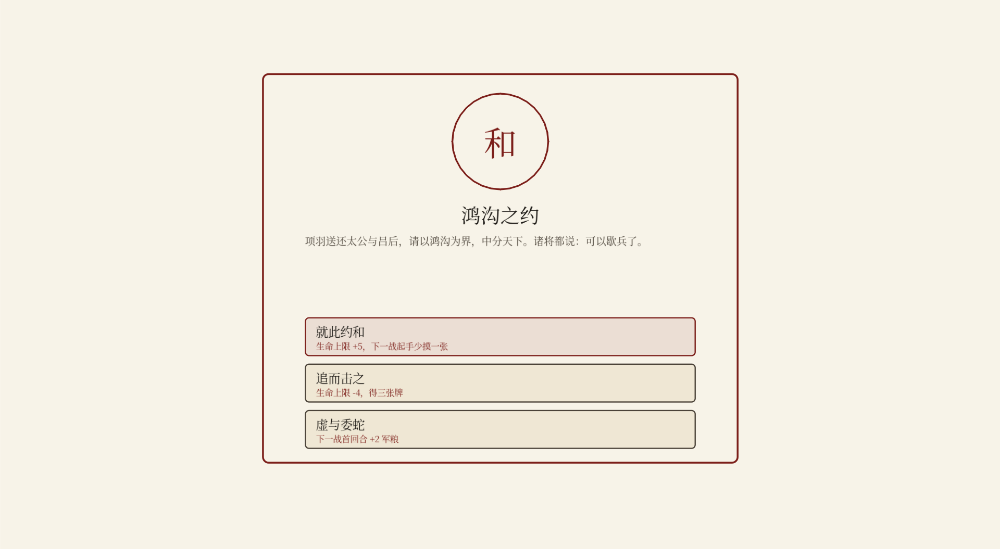

# 楚汉·问鼎

楚汉争霸主题的水墨卡牌对战游戏。炉石式骨架 + 三列军阵的原创玩法，含 8 关 PvE 战役、快速对战与好友联机。当前版本 **v0.9.1**（开发中，目标 Steam 上架）。



## 玩法特色

- **三列军阵**：兵→前锋、车→中军、士将→后卫，牌不是丢进场就完事，站位即策略
- **楚汉双雄**：刘邦 30 血续航 vs 项羽 26 血强攻，技能 1 费、风格迥异
- **原创关键词**：冲锋（登场可攻）· 死战（阵亡触发）· 连击（本回合已出过牌）· 守御 · 迂回 · 远程
- **Roguelike 战役**：沛县起兵一路打到垓下，8 关战后三选一加牌、军师 5 选 3、关间随机事件 16 个、三存档位
- **PvP 好友房**：确定性锁步联机（只传动作、双方牌序一致），快捷短语 + 限时 + 断线重连
- **中英双语**、内置字体、BGM/SFX 双总线

## 技术栈

| 层 | 技术 |
|---|---|
| 主工程 | **Godot 4.7**（GDScript），`godot/` |
| 参照实现 | 原型期 JS/Canvas 版，保留作数值参照与等价性基准，`js/` |
| 数据 | 卡牌/事件/军师/关卡单源 JSON（`godot/data/`），由 `tools/export-data.js` 从 JS 源导出 |
| 联机 | WebSocket 中继（`tools/relay.js`，可部署到任意 Node 服务器） |
| 美术 | 98 张 AI 水墨立绘（`godot/assets/cards/`） |

**确定性引擎**：双端共用 xorshift32 RNG，只同步玩家动作即可逐帧一致——同一场录像是「JS 打一遍 + GDScript 重放一遍」逐项比对验证的（等价性测试 333 项）。

## 运行

### 玩（Windows）

`godot/export/ChuHanWenDing.exe` 不入库，用 Godot 4.7 打开 `godot/project.godot` 直接 F5 运行；或自行导出（导出预设已配好）。

### 开发

```bash
# JS 参照版（浏览器直接打开 index.html，或 Electron 壳）
npm start

# 部署联机中继（服务器上）
node tools/relay.js 27775
```

### 测试

Godot 侧（headless）：

```bash
Godot --headless --path godot --script res://tests/replay.gd        # 双端等价性 333 项
Godot --headless --path godot --script res://tests/campaign_test.gd # 战役 152 项
# 其余：audio / codex / tutorial / i18n / pvp / battle_ui / fonts / card_art /
#       art_rect / keyword_stamp / event_pick …共 1942 项 + E2E 19 项（-- --flow）
```

JS 侧：`node test/<name>.js`（balance / tune-roguelike / sweep-stages 等数值回归）。

## 目录结构

```
godot/            主工程（core 引擎 / scenes 场景 / ui 组件 / tests 测试 / data 数据）
js/               JS 参照实现（engine.js 规则引擎 / campaign.js 战役与事件 / lang-en.js 英文）
test/             JS 数值与平衡测试
tools/            数据导出、字体子集化、联机中继、等价性 trace 录制
docs/             设计文档、路线图、技术备忘（踩坑清单在 technical.md 第 39、40 条）
```

## 状态与计划

当前在「内容扩展」阶段（1.3 事件 ✅ → 下一步 1.4 军师 6→8），之后 Steam 上架（Godot 导出直传）。完整路线见 [docs/roadmap.md](docs/roadmap.md)，进度明细见 [docs/next-steps.md](docs/next-steps.md)。

## 许可

`UNLICENSED`（保留所有权利）。代码与美术暂不授权转载；关键词条目、规则数值的设计思路欢迎交流。
