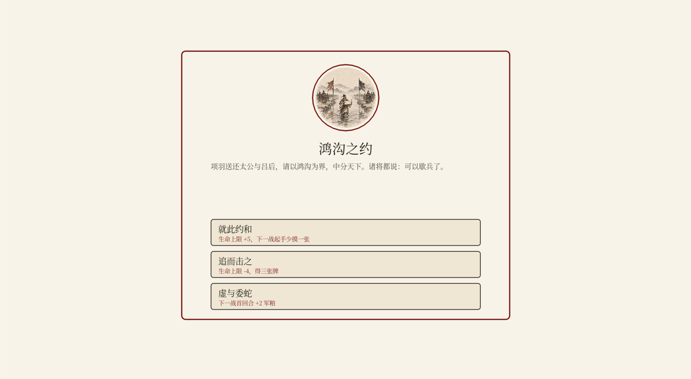

# 楚汉·问鼎

楚汉争霸主题的水墨卡牌对战游戏。炉石式骨架 + 三列军阵的原创玩法，含 8 关 PvE 战役、快速对战与好友联机。当前版本 **v0.9.4**（开发中）。



## 玩法特色

- **三列军阵**：兵→前锋、车→中军、士将→后卫，牌不是丢进场就完事，站位即策略
- **楚汉双雄**：刘邦 30 血续航 vs 项羽 26 血强攻，技能 1 费、风格迥异
- **原创关键词**：冲锋（登场可攻）· 死战（阵亡触发）· 连击（本回合已出过牌）· 守御 · 迂回 · 远程
- **Roguelike 战役**：沛县起兵一路打到垓下，8 关战后三选一加牌、军师 8 位、关间随机事件 16 个、三存档位
- **PvP 好友房**：确定性锁步联机（只传动作、双方牌序一致），快捷短语 + 限时 + 断线重连
- **中英双语**、内置字体、BGM/SFX 双总线

## 技术栈

| 层 | 技术 |
|---|---|
| 主工程 | **Godot 4.7**（GDScript），`godot/` |
| 参照实现 | 原型期 JS/Canvas 版，保留作数值参照与等价性基准：逻辑在 `js/`，网页壳已归档到 `legacy/` |
| 数据 | 卡牌/事件/军师/关卡单源 JSON（`godot/data/`），由 `tools/export-data.js` 从 JS 源导出 |
| 联机 | WebSocket 中继（`tools/relay.js`，可部署到任意 Node 服务器） |
| 美术 | 115 张 AI 水墨立绘（`godot/assets/cards/`，卡池 78 张全有图） |

**确定性引擎**：双端共用 xorshift32 RNG，只同步玩家动作即可逐帧一致——同一场录像是「JS 打一遍 + GDScript 重放一遍」逐项比对验证的（等价性测试 629 项 / 20 场景）。

## 运行

### 玩（Windows）

`godot/export/ChuHanWenDing.exe` 不入库，用 Godot 4.7 打开 `godot/project.godot` 直接 F5 运行；或自行导出（导出预设已配好）。

### 开发

```bash
# JS 参照版（已归档，只读）：浏览器直接打开 legacy/web/index.html
# 或用已弃用的 Electron 壳：env -u ELECTRON_RUN_AS_NODE npm start

# 部署联机中继（服务器上）
node tools/relay.js 27775
```

### 测试

Godot 侧（headless）：

```bash
Godot --headless --path godot --script res://tests/replay.gd        # 双端等价性 629 项
Godot --headless --path godot --script res://tests/campaign_test.gd # 战役 168 项
Godot --headless --path godot --script res://tests/pvp_test.gd      # 联机 35 项（含真断线重连）
# 其余：audio / codex / tutorial / i18n / battle_ui / fonts / card_art /
#       art_rect / keyword_stamp / event_pick / advisor …共 2142 项 + E2E 19 项（-- --flow）
# 中继自测：node tools/relay-smoke.js（20 项）
```

JS 侧：`node test/<name>.js`（campaign 1828 / tune-roguelike / sweep-stages 等数值回归）。
网页版界面巡检在 `legacy/checks/`，需用 `CHROME=<浏览器路径>` 指定 Chrome 或 Edge。

## 目录结构

```
godot/               主工程（core 引擎 / scenes 场景 / ui 组件 / tests 测试 / data 数据）
js/                  数据单源 + 规则引擎（export-data.js / trace.js / tune-* 都读它）
legacy/web/          已冻结的网页版（双击 index.html 可玩，只读，别加功能）
legacy/checks/       网页版浏览器验收脚本（uicheck / flow / art-check …）
test/                JS 数值与平衡测试
tools/               数据导出、字体子集化、联机中继（含 /health）、等价性 trace 录制
docs/                设计文档、路线图、技术备忘（踩坑清单在 technical.md）
```

## 状态与计划

内容扩展阶段已收尾（事件 16 个 ✅、军师 8 位 ✅、连击卡 8 张 ✅、初阵档位 ✅、立绘 115 张齐全 ✅ → 工程债：JS 归档 ✅、断线重连自动化验收 ✅、中继监控 ✅），下一步是 Steam 商店素材与上架流程。完整路线见 [docs/roadmap.md](docs/roadmap.md)，进度明细见 [docs/next-steps.md](docs/next-steps.md)。

## 许可

`UNLICENSED`（保留所有权利）。代码与美术暂不授权转载；关键词条目、规则数值的设计思路欢迎交流。
